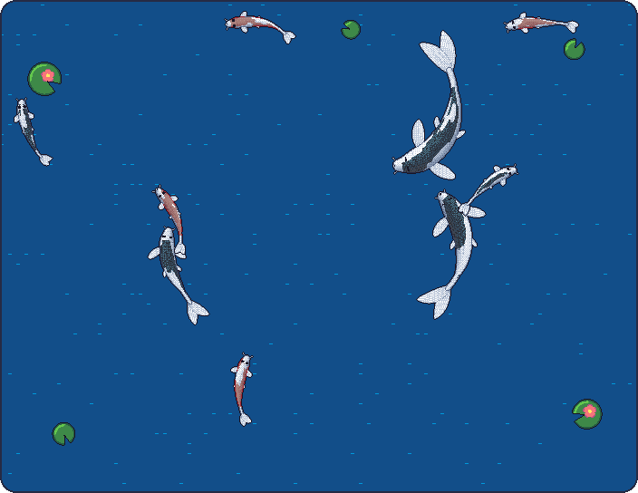

# Koi pond

A pixel-art koi pond for a GitHub profile. Every public repository you own becomes a
koi: its language colors it, its commits grow it, and the busiest repository is the
biggest fish. The koi cruise among lily pads and lotus flowers, and a nightly workflow
redraws the pond so new projects hatch and growing ones get bigger.

<p align="center">
  
</p>

## Usage

Requires Rust 1.88 or later and an authenticated [GitHub CLI](https://cli.github.com).

```sh
cargo install --locked --git https://github.com/Rmanjini/koi-pond git-koi
git-koi pond LOGIN --output-dir koi --body white
```

This writes `koi/pond.gif`. The body is one of `white`, `black`, `asagi`, `tea`, `gold`,
or `platinum`.

- One koi per public, non-fork repository the account owns, up to the busiest 12.
- Size follows the commits on each repository's default branch, relative to the busiest.
- Color follows each repository's primary language.

## On your profile

Copy [examples/pond-workflow.yml](examples/pond-workflow.yml) into your profile
repository (`LOGIN/LOGIN`) as `.github/workflows/pond.yml`, run it once from the
Actions tab, and add this to its `README.md`:

```html

```

## License

MIT. See [LICENSE](LICENSE).
